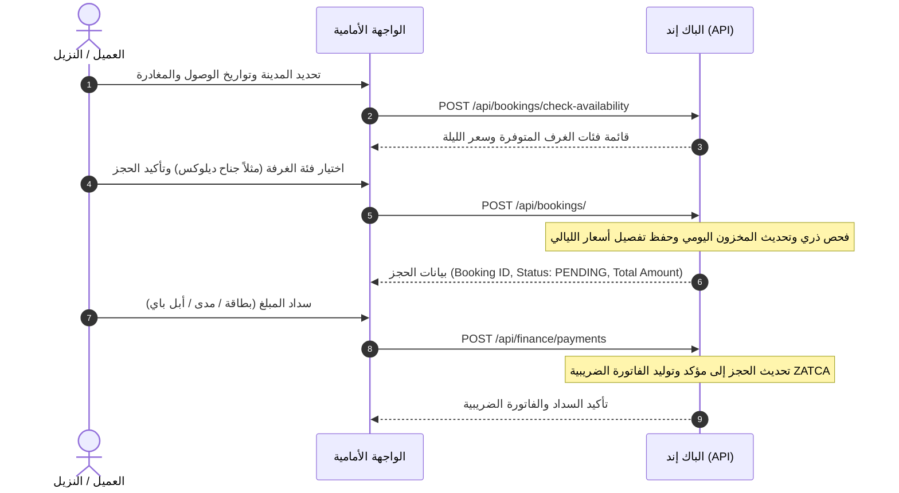

# 📋 دليل تسليم الواجهة الأمامية (Frontend Handoff Guide)
**المشروع:** Hotel LinkEX (محرك حجز وإدارة الفنادق والوحدات السكنية)  
**الموجّه إلى:** حسين (مهندس الفرونت إند - Frontend Engineer)  
**من طرف:** أسامة (مسؤول الباك إند - Backend Lead)  

---

## 🎯 1. روابط ومعلومات الوصول السريع (Quick Links)

* **مستودع الكود (GitHub Repo):**  
  👉 [https://github.com/linkex210-max/Hotel_LinkEX](https://github.com/linkex210-max/Hotel_LinkEX)
* **رابط الـ API الأساسي (Base URL):**  
  `http://127.0.0.1:8000/api`
* **توثيق الـ API التفاعلي (Swagger UI):**  
  👉 `http://127.0.0.1:8000/api/docs`
* **مواصفة الـ API الكاملة (OpenAPI 3.1 Spec):**  
  موجودة كملف جاهز في المستودع: `openapi.json` أو عبر الرابط: `http://127.0.0.1:8000/api/openapi.json`
* **لوحة تحكم جانغو (Django Admin):**  
  `http://127.0.0.1:8000/admin/`  
  - **البريد:** `admin@linkex.com`  
  - **كلمة المرور:** `admin123`

---

## ⚡ 2. تشغيل السيرفر المحلي لديك (Local Backend Setup)

إذا أردت تشغيل الباك إند محلياً على جهازك للتطوير:
1. استنسخ المستودع:
   ```bash
   git clone https://github.com/linkex210-max/Hotel_LinkEX.git
   cd Hotel_LinkEX
   ```
2. شغّل الباك إند فوراً:
   - في ويندوز: اضغط مرتين على ملف **`run.bat`** (سيقوم بتفعيل البيئة وتشغيل السيرفر تلقائياً).
   - أو عبر الأوامر:
     ```bash
     .\.venv\Scripts\activate
     python backend\manage.py runserver
     ```

> **ملاحظة:** الـ **CORS** مفعل بالكامل (`CORS_ALLOW_ALL_ORIGINS = True`) أثناء وضع التطوير، فلن تواجه أي مشاكل ربط مع React / Next.js / Vue.

---

## 🛠 3. توليد الـ TypeScript Types تلقائياً في 5 ثوانٍ!

بدلاً من كتابة الـ Types والـ Interfaces يدوياً، تم تجهيز ملف `openapi.json`. يمكنك تشغيل الأمر التالي في مشروع الفرونت إند لتوليد كافة الـ Types لجميع الـ Models والـ Requests والـ Responses:

```bash
npx openapi-typescript openapi.json -o src/types/api.ts
```

---

## 🔐 4. نظام المصادقة والصلاحيات (Authentication Flow)

يستخدم النظام معيار **JWT Bearer Token**:
* عند إرسال أي طلب محمي، أضف الترويسة التالية:
  ```http
  Authorization: Bearer <access_token>
  ```
* **تسجيل الدخول:**
  - `POST /api/users/login`
  - إرسال: `{"email": "...", "password": "..."}`
  - الاستجابة:
    ```json
    {
      "access_token": "eyJhbG...",
      "refresh_token": "eyJhbG...",
      "token_type": "bearer"
    }
    ```
* **الأدوار المتاحة (Roles):**
  - `SUPER_ADMIN`: إدارة كاملة للمنصة.
  - `PROPERTY_MANAGER`: مدير مبنى/فندق محدد (محدد بالـ Property Scope).
  - `RECEPTIONIST`: موظف استقبال (تسكين، Check-in/out).
  - `ACCOUNTANT`: محاسب (اعتماد السندات، المصروفات، كشوفات الملاك).
  - `GUEST`: نزيل/عميل حجز.

---

## 📱 5. خرائط وتدفقات العمليات في الفرونت إند (Core User Journeys)

### أولاً: رحلة العميل والبحث والحجز (Guest Booking App)



1. **فحص التوفر اليومي:**
   - `POST /api/bookings/check-availability`
   - ترسل: `{"property_id": 1, "check_in_date": "2026-12-01", "check_out_date": "2026-12-04", "rooms_count": 1}`
   - يرجع لك التوفر الفوري $O(1)$ لكل فئة غرفة.
2. **إنشاء الحجز:**
   - `POST /api/bookings/`
   - ترسل: `{"room_type_id": 1, "guest_name": "سعد", "guest_phone": "0555...", "check_in_date": "...", "check_out_date": "..."}`
   - **ملاحظة:** الحجز في الفنادق يتم على `room_type_id`. أما في الشاليهات فيمكنك تمرير `unit_id` المحددة إن وجدت.
   - الرد يحتوي على تفصيل الليالي `nights_breakdown`:
     ```json
     [
       {"date": "2026-12-01", "rate": 400.0},
       {"date": "2026-12-02", "rate": 500.0}
     ]
     ```
3. **سداد الحجز:**
   - `POST /api/finance/payments`
   - ترسل: `{"booking_id": 1, "amount": 900.0, "method": "CARD", "transaction_reference": "TXN_123"}`
   - فور سداد المبلغ بالكامل، يتحول الحجز إلى `CONFIRMED` وتصدر الفاتورة الضريبية تلقائياً.
4. **استعراض الفاتورة الضريبية (ZATCA QR & Hash):**
   - `GET /api/finance/invoices/{invoice_number}`
   - يرجع حقل `qr_code_data` بصيغة Base64 TLV، جاهز للعرض مباشرة كمربع باركود QR Code في شاشة الفاتورة.

---

### ثانياً: شاشات الاستقبال والتشغيل الفندقي (Reception Dashboard)

1. **تسكين النزيل وتعيين رقم الغرفة:**
   - `POST /api/bookings/{booking_id}/assign-room`
   - موظف الاستقبال يختار غرفة نظيفة وجاهزة (`AVAILABLE`) تتبع لنفس الفئة ويسندها للحجز:
     `{"unit_id": 102}`
2. **تسجيل الدخول (Check-in):**
   - `POST /api/bookings/{booking_id}/check-in`
   - يشترط أن يكون الحجز مدفوعاً (`is_paid == true`) وتم تعيين الغرفة له.
   - تتحول حالة الغرفة تلقائياً إلى **مشغولة (`OCCUPIED`)**.
3. **تسجيل الخروج (Check-out):**
   - `POST /api/bookings/{booking_id}/check-out`
   - تتحول الغرفة تلقائياً إلى وضع **التنظيف والتجهيز (`CLEANING`)**.
4. **إلغاء الحجز:**
   - `POST /api/bookings/{booking_id}/cancel`
   - يحرر المخزون اليومي ويعيد الغرفة للحالة المتاحة.

---

### ثالثاً: شاشات الإدارة والمالية والملاك (Owner & Finance Portal)

1. **استعراض تقويم المخزون والأسعار اليومية:**
   - `GET /api/properties/room-types/{room_type_id}/inventory?start_date=2026-12-01&end_date=2026-12-31`
2. **اعتماد السندات والتحويلات البنكية:**
   - `POST /api/finance/payments/{payment_id}/verify`
3. **تسجيل المصروفات التشغيلية للمبنى:**
   - `POST /api/finance/expenses`
4. **تصدير كشف حساب المالك:**
   - `POST /api/finance/statements/generate?property_id=1&start_date=...&end_date=...`
   - يحسب تلقائياً: إجمالي الإيرادات، المصروفات، عمولة الإدارة، وصافي المستحق للمالك.

---

## 🚨 6. معالجة الأخطاء (Error Handling)

جميع رسائل الأخطاء تعود بصيغة JSON واضحة وموحدة:
* خطأ تحقق مدخلات: `400 Bad Request` مع `{"error": "وصف المشكلة"}`
* خطأ صلاحية أو وصول لبيانات حجز غير مصرح: `403 Forbidden` مع `{"error": "..."}`
* خطأ مصادقة: `401 Unauthorized`

---
*فريق الباك إند متواجد معك لأي استفسار أو إضافة مسارات جديدة تحتاجها أثناء بناء الواجهات! بالتوفيق يا حسين.*
